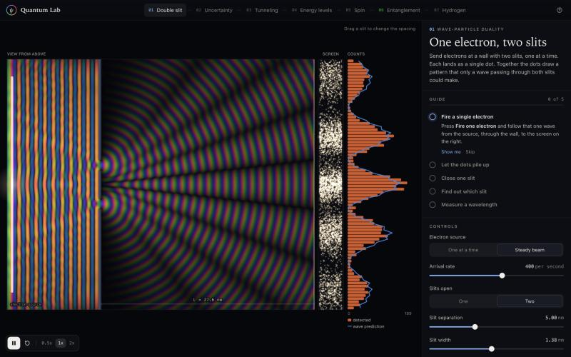
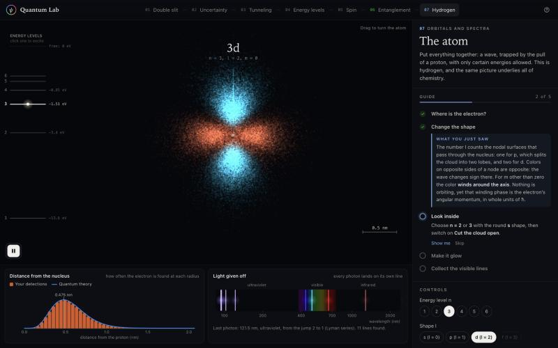

# Quantum Lab

Quantum Lab is seven hands-on quantum mechanics experiments, with the Schrödinger equation solved live in the browser.





Nothing on the benches is a recorded animation. Waves are advanced by real solvers as you drag, fire and measure, and every dot, click and count is drawn at random from the probabilities those waves give.

## Run it

```bash
node serve.mjs
```

Then open http://127.0.0.1:8490. There is no build step and there are no dependencies: any static file server pointed at this folder works just as well. The double slit and hydrogen stations need WebGL2.

## The seven stations

Each station is one apparatus, a short guide, and live readouts. The guide asks for a prediction, has you run the experiment, then explains what you just saw.

| # | Station | What you do | What it shows |
| --- | --- | --- | --- |
| 1 | Double slit | Fire electrons one at a time, close a slit, switch on a which-slit detector, drag the slits | Single dots build an interference pattern. Path information destroys it. Fringe spacing follows wavelength x distance / separation |
| 2 | Uncertainty | Squeeze a wave packet by its handles, measure 200 identical electrons, release it | Position and momentum pictures are Fourier pairs. The product of their spreads never drops below hbar / 2 |
| 3 | Tunneling | Launch a packet at a barrier, drag its height and width, trace transmission against energy | Exponential leakage through a wall, reflection above it, resonance between two walls |
| 4 | Energy levels | Click levels, drag walls, mix states, measure energy or position, sculpt the well | Quantization, stationary states, motion as interference between levels, collapse, tunneling between two wells |
| 5 | Spin | Chain up to three Stern-Gerlach analyzers, turn their dials, block or rejoin beams | Two outcomes only, repeatable measurements, incompatible questions, a measurement that erases an earlier one |
| 6 | Entanglement | Turn Alice's and Bob's analyzers, swap entangled pairs for classical twins, run Bell's test | Correlations no pre-agreed instructions can match: S reaches 2.83 where any local scheme stops at 2. No signalling |
| 7 | Hydrogen | Build the electron cloud detection by detection, change n, l, m, cut it open, excite it | Orbitals as clouds of measurements, nodes, and the emission lines of the Balmer series |

## Under the hood

Plain script tags, one global namespace (`QL`), no framework.

| File | Role |
| --- | --- |
| `src/engines/wave2d.js` | 2D time-dependent Schrödinger equation on the GPU. Visscher staggered leapfrog on a 720 x 600 grid, two complex fields per texel so which-path branches evolve side by side, hard walls and an absorbing border from a mask texture |
| `src/engines/wave1d.js` | 1D time-dependent Schrödinger equation, Crank-Nicolson, unitary to rounding error, with absorbing edges and hard walls |
| `src/core/math.js` | FFT, Sturm bisection plus pivoted inverse iteration for eigenstates, exact transfer-matrix transmission, sampling |
| `src/stations/atom.js` | Exact hydrogen orbitals (Laguerre and Legendre recurrences), inverse-CDF sampling of 90,000 detections, dipole decay rates from radial overlap integrals |
| `src/core/plot.js`, `draw.js`, `guide.js`, `ui.js` | Charts with crosshair tooltips, canvas helpers, the mission guide, controls |
| `src/lab.js` | Shell: station lifecycle, frame loop, persistence of guide progress in localStorage |

Real units where they help. The 1D stations use an electron with lengths in nanometres, so energies come out in electronvolts and times in femtoseconds. Hydrogen uses the Bohr radius and the Rydberg energy.

## What is modelled, and what is not

- Everything is non-relativistic, single-particle quantum mechanics. Spin is treated as an ideal two-state system.
- Double slit: the grid's own dispersion sets the wave speed, so the wavelength is exact but the energy-to-wavelength map is for the lattice. The which-slit detector is an ideal marker: the two paths become two fields that are added as probabilities instead of amplitudes. Electrons that hit the wall are not shown; each shot is conditioned on reaching the screen.
- Tunneling and energy levels: one dimension. The eigen-solver and the time stepper share one finite-difference Hamiltonian, so stationary states stay exactly stationary.
- Entanglement: an ideal singlet source and perfect detectors. The classical twins use one specific hidden-variable rule. It saturates Bell's bound, which is a theorem about every such rule.
- Hydrogen: no fine structure, no spin, states up to n = 6 with l up to 3. Decay branching uses electric dipole rates only, so 2s is correctly stuck.

## Checks

```bash
node tests/numerics.mjs
```

Compares the solvers with closed-form results: oscillator and box energies, norm conservation, stationary states staying put, tunneling against the transfer matrix, hydrogen mean radii and branching ratios (3p to 1s at 88%), the Balmer and Lyman wavelengths, and CHSH values of 2.83 and 2.00 for the two sources.

## Keys

| Key | Action |
| --- | --- |
| Space | Play or pause |
| R | Restart or prepare again |
| F | Fire an electron or atom (double slit, spin), let the atom fall (hydrogen) |
| E, X | Measure energy, measure position (energy levels) |
| B | Run Bell's test |
| 1 to 7, [ and ] | Jump between stations |
| ? | Color legend and key list |
