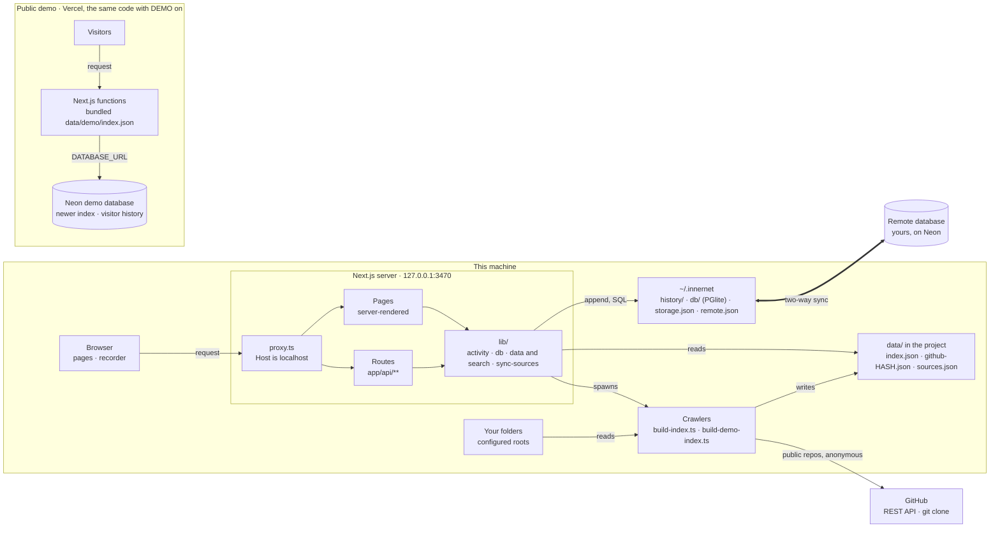
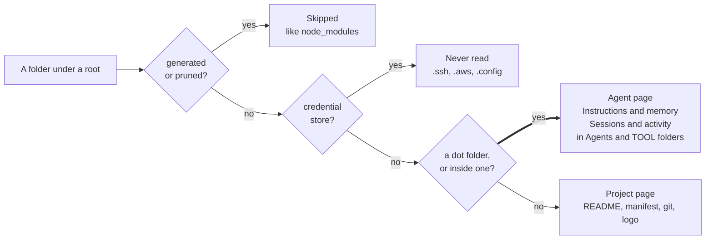
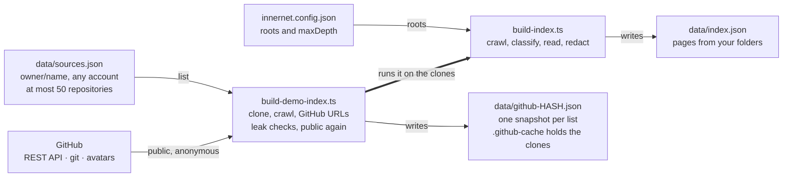
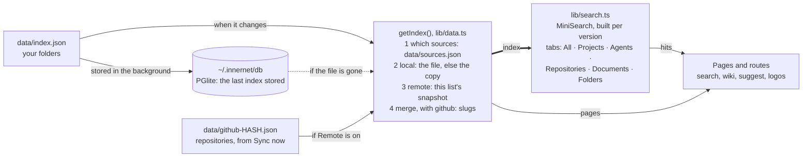
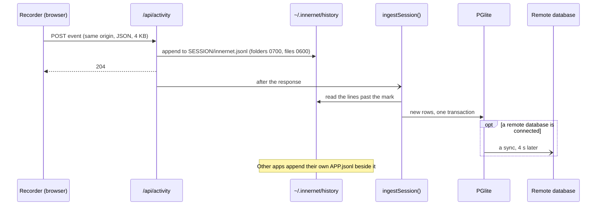
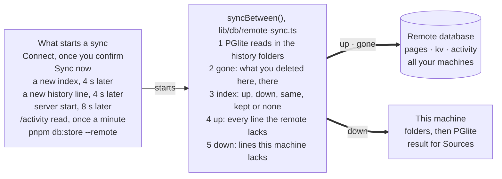
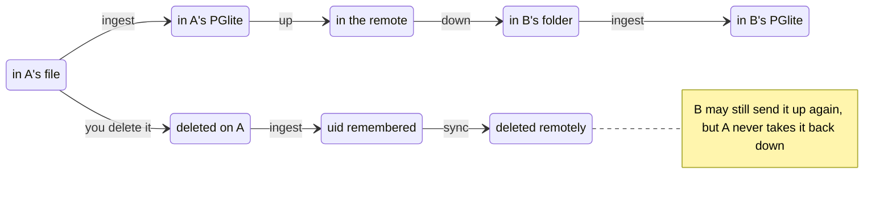
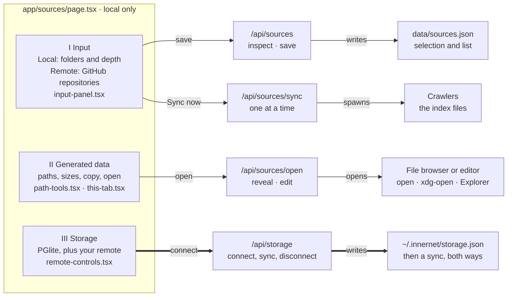
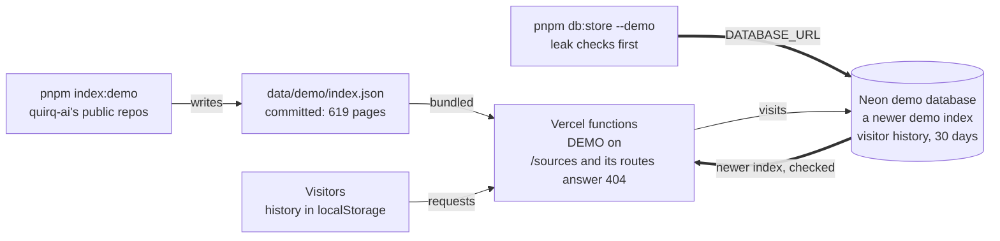
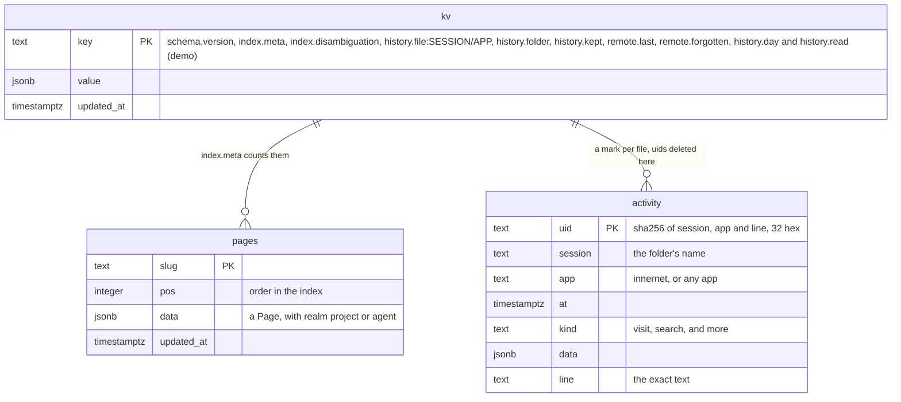

# Innernet architecture

A Next.js app that turns the folders on one machine, and any public GitHub repositories
you list, into a search engine and an encyclopedia, Innerpedia. Dot folders become agents
beside projects, every page opened is kept as a line in a history folder with a copy in
PGlite, and both can be kept in step with a remote Postgres you connect. Left out here:
the visual layer (CSS, the globe, the guide's film) and the crawler's image decoding.

The same sections, drawn by hand, are published as the
[Innernet Architecture](https://claude.ai/artifact/5HSJvc2JS9RbcAwKcA6ApD) page. Keep the
two in step when either changes. Written from `main` at `da9b84c`.

| Mode | Routes | Index | Database | History |
| --- | --- | --- | --- | --- |
| Local | `/` · `/search` · `/wiki/[slug]` · `/activity` · `/sources` | `data/index.json` and your repositories' snapshot, as chosen on Sources | PGlite in `~/.innernet/db`, plus your remote Neon once connected | `~/.innernet/history`, a folder per tab |
| Demo | The same, without `/sources` | `data/demo/index.json`, or a newer one in Neon | Neon through `DATABASE_URL` | The visitor's browser, and Neon for 30 days |

1. [System context](#1-system-context)
2. [Indexing](#2-indexing-folders-and-repositories-become-pages)
3. [Reading](#3-reading-one-index-from-the-chosen-sources)
4. [History](#4-history-recording-a-visit)
5. [Remote sync](#5-remote-sync-a-second-copy-kept-in-step)
6. [The Sources page](#6-the-sources-page)
7. [The demo](#7-the-demo-on-vercel)
8. [Access model](#8-access-model)
9. [Data model](#9-data-model)
10. [Folder map](#10-folder-map)

## 1. System context

The browser only talks to the Next.js server, which answers only to localhost. Every page
and route goes through `lib/`: the index is held in memory, the history is appended to
files in `~/.innernet`, and PGlite in the same folder keeps a copy of both. The crawlers
are separate processes that write the index files; the server starts them when you press
Sync now.

**Your data leaves this machine on one edge, and only after you connect.** The sync to
your own remote database is the only path that carries the index or the history away.
GitHub is read anonymously, and only for the repositories you list. The demo shares no
runtime with this machine; `pnpm db:store --demo` is its one way in (section 7).

## 2. Indexing: folders and repositories become pages

Two crawlers write the index files, and nothing else does. Sync now on Sources runs
whichever inputs are selected, one sync at a time with a five-minute limit; `pnpm index`
and `pnpm index:demo` run them by hand. As it walks, the crawl sorts every folder into one
of two realms: projects, and agents.

**A dot folder belongs to an agent unless a tool generated it or it holds credentials.**
`lib/agents.ts` keeps the lists, and the crawler, `normalizeIndex()` and the pages all read
them, so the three agree. An agent page shows named instruction and memory files (up to
8,000 characters each, from `CLAUDE.md`, `AGENTS.md`, rules and memory folders) and lists
sessions by name, size and date, never their contents.

**One crawl, two inputs.** The GitHub crawler clones each listed repository anonymously,
runs the ordinary crawl on the clones, turns every path into its GitHub URL, confirms each
repository is still public, and writes nothing if any string still names this machine.
Each list of repositories has its own snapshot, named by a hash of the list, so a changed
list never shows another list's pages.

## 3. Reading: one index from the chosen sources

`getIndex()` in `lib/data.ts` is the one door to the index for every page and route. It
answers from memory and merges the sources chosen on Sources; the database only ever
stands in for a missing file.

**Pages never wait on a database.** `getIndex()` checks each file's size and times on
every call and parses it again only when they change. A new local index is stored in
PGlite in the background, and that copy is served only when `data/index.json` is gone.
Remote pages join under `github:` slugs, and a name found in both sources gets a list of
its own.

## 4. History: recording a visit

Every route change in the browser becomes one event: a visit, a search, back or forward.
Sources adds its own events (sources saved, a sync, a connection). The folders are the
record and the format any app can add to; PGlite and the remote database hold copies.

**The line is on disk before the browser hears back.** `appendEvent()` writes the
session's file without following links; once the 204 is sent, `after()` reads that session
into PGlite from its last mark, and a connected remote database is synced a few seconds
later. Another app's `APP.jsonl` is read the same way, and the history page reads sessions
back from PGlite, or from the files when the database is off.

## 5. Remote sync: a second copy, kept in step

Connecting adds a second copy beside PGlite; it never replaces it. One sync runs at a
time, in the order below, and it deletes nothing remotely except history you deleted
here, so one machine never wipes another's.

**Only what you delete here is ever deleted there.** A sync first lets PGlite catch up
with the folders, deletes remotely the lines you removed, settles the index, and moves the
missing lines each way by uid (a hash of session, app and line). Lines that come down are
written into the history folders, which stay the record, and PGlite takes them from there
like any app's. Pages go up 400 a request with the meta last, and the result is kept in
`kv remote.last` for Sources to show.

| Index | When |
| --- | --- |
| `up` | This machine indexes its own folders, and its index is newer than the remote's (or the remote has none) |
| `down` | This machine has no `data/index.json`, or it follows the remote and the remote's index is newer. The file is written with `meta.fromRemote`, and from then on it follows |
| `same` | Both hold the index with the same `generatedAt` |
| `kept` | Both hold one, and this machine keeps its own, older than the remote's |
| `none` | Neither side has an index |

**A line belongs to every machine until one of them deletes it.** A deletion is remembered
as the line's uid (the newest 20,000 in `kv remote.forgotten`, recorded only while a remote
is connected), so the next sync deletes it remotely and later syncs never pull it back.

## 6. The Sources page

`/sources` is one server page in three parts, each backed by its own route. Input chooses
what is indexed, Generated data lists every file the input makes by its relative path,
and Storage shows this machine's database and the remote one, with Test to reach it
without connecting. The page and its routes exist only in local mode.

**Connect asks once, in place, and the server checks it again.** The remote controls open
an inline notice naming what will be copied; `/api/storage` refuses `connect` without
`confirm: true`, reaches the database before it saves `connected: true`, and syncs at
once. Every route here takes only same-origin JSON (8 KB, or 1 KB for a sync) and answers
404 on the demo; a save, a sync of sources, a connect and a disconnect each add an event to
the tab's history.

## 7. The demo on Vercel

Vercel runs the same code with `DEMO` on. Every function carries the committed index of
quirq-ai's public repositories; when `DATABASE_URL` is set, the server checks Neon at most
every five minutes for a newer index, and keeps visitors' history there for 30 days.

**Only public data reaches the demo, and it is checked on the way in and on the way out.**
`pnpm index:demo` writes nothing if any string names this machine; `pnpm db:store --demo`
and the server both run `lib/demo-check.ts` before Neon's index is stored or served.
Visitors' events are kept under a hash of the session id, capped at 400 a session and
10,000 a day, with no IP address, user agent or cookie.

## 8. Access model

- **Localhost only.** `pnpm dev` and `pnpm start` bind to 127.0.0.1:3470, and `proxy.ts`
  answers 403 to any other Host, so a page that rebinds its DNS name to 127.0.0.1 is
  refused. The demo answers every host.
- **Same origin, small bodies.** Every route that reads a body checks `Origin` and
  `Sec-Fetch-Site` and stops reading past a cap (`lib/same-origin.ts`): 4 KB for a history
  event (2 KB on the demo), 8 KB for Sources, 1 KB for a sync.
- **Local only.** `/sources`, `/api/sources/*`, `/api/storage` and `/api/db/store` answer
  404 on the demo.
- **Secrets stay in `~/.innernet`.** `remote.json` holds your remote's URL; it is never
  logged or sent to a browser, and pages show only a label such as "innernet-personal on
  Neon, us-east-1". `storage.json` is written 0600 in a 0700 folder. A build that can see
  `DATABASE_URL` keeps no Turbopack cache, so the demo's string never lands in `.next`.
- **The browser reaches nothing else.** The Content-Security-Policy holds every script,
  fetch, image and form to the same origin, and a logo is served as a sandboxed image.

| Database | Opened by | Holds | Refused |
| --- | --- | --- | --- |
| PGlite, `~/.innernet/db` | The local server, one process at a time (`owner.lock`), or `pnpm db:*` | A copy of the index and history, file marks, the last sync, deleted uids | On the demo, which never ships it |
| Your remote (Neon) | `lib/db/remote-sync.ts` while connected, or `pnpm db:* --remote` | The index and history of every machine you connect | On the demo, and when its URL is the demo's |
| The demo's Neon | Vercel functions, or `pnpm db:store --demo` | The demo index, and visitors' history under hashed session keys | In local mode: `openNeon()` throws |

## 9. Data model

Both drivers share one schema of three tables, made idempotently when a database opens
(schema version 1), in plain SQL with no ORM. The demo uses the same tables: its index in
`pages` and `kv`, its visitors' events in `activity`.

`activity` is indexed by `(session, at)` and by `(at)`.

**The files are the record; the tables are copies that can rebuild them.** `activity.line`
keeps each line exactly as read, so `pnpm db:load` writes back what was stored, and the uid
makes storing a line twice keep one row. A reader trusts `pages` only when `index.meta`
counts them, so a sync cut short never serves half an index.

| File | Shape | Written by |
| --- | --- | --- |
| `data/index.json` | `SiteIndex`: `meta`, `pages`, `disambiguation` | `build-index.ts` |
| `data/github-<hash>.json` | The same, one per list of repositories | `build-demo-index.ts`, on Sync now |
| `data/demo/index.json` | The same, committed | `pnpm index:demo` |
| `data/sources.json` | `local`, `remote`, `remoteConfig.repositories` | Sources |
| `innernet.config.json` | `roots`, `maxDepth` | You |
| `~/.innernet/history/<session>/<app>.jsonl` | One event per line: `at`, `app`, `kind`, then free fields | The server, and any other app |
| `~/.innernet/storage.json` | `connected` | Sources |
| `~/.innernet/remote.json` | `url`, `provider`, `name` | You, once |

## 10. Folder map

346 tracked files. Directories are tagged by the mode they serve; shared code runs in both.

| Path | Mode | Purpose |
| --- | --- | --- |
| `app/` | shared | App Router: pages and route handlers |
| `app/page.tsx` | shared | Home: search, recently touched, the field guide |
| `app/search/` | shared | Results, six tabs, operators, did-you-mean |
| `app/wiki/` | shared | Innerpedia: Main page, articles, agent pages, categories |
| `app/activity/` | shared | History: PGlite or the files here, the browser on the demo |
| `app/sources/` | local | Input, generated data, storage |
| `app/api/activity/` | shared | Record a visit; on the demo, also read and clear |
| `app/api/suggest/` · `app/api/logo/[id]/` | shared | Suggestions as you type; logos by hash, sandboxed |
| `app/api/sources/` | local | Inspect, save, sync, open a location |
| `app/api/storage/` · `app/api/db/store/` | local | Connect and sync the remote; Store now |
| `components/` | shared | 89 files, 18 of them client components |
| `components/activity/` | shared | Recorder, back and forward, the history format (`shared.ts`) |
| `components/sources/` | local | Input panel, path tools, remote controls |
| `components/wiki/` | shared | Article sections (agent ones included), globe, infobox |
| `components/search/` · `home/` · `guide/` | shared | Results, the home page, the field guide |
| `lib/` | shared | Server logic, and the rules pages and crawlers share |
| `lib/data.ts` · `merge-indexes.ts` · `normalize.ts` | shared | Load, merge and update the index |
| `lib/search.ts` | shared | MiniSearch, ranking, tabs, suggestions |
| `lib/agents.ts` | shared | Which dot folders are agents, and their tools |
| `lib/activity.ts` | local | History folders: append and read |
| `lib/sources.ts` · `remote-config.ts` · `sync-sources.ts` | local | Input settings, repository links, Sync now |
| `lib/source-storage.ts` · `storage.ts` | local | Generated data; the remote's settings |
| `lib/mode.ts` · `same-origin.ts` · `demo-check.ts` | shared | DEMO, request checks, leak checks |
| `lib/db/` | shared | Every database behind one `Db` interface |
| `lib/db/pglite.ts` · `ingest.ts` · `tombstones.ts` | local | This machine's database and its history |
| `lib/db/remote-sync.ts` | local | Two-way sync with your remote |
| `lib/db/neon.ts` | shared | Neon over HTTPS: the demo's, or yours |
| `lib/db/demo-history.ts` | demo | Visitors' history, hashed and capped |
| `lib/db/schema.ts` · `sync.ts` · `index-store.ts` | shared | Tables; the index stored and read back |
| `scripts/` | shared | Command-line tools and checks, run with tsx |
| `scripts/build-index.ts` | local | The crawl |
| `scripts/build-demo-index.ts` | shared | GitHub: the demo's index, and Remote input |
| `scripts/db.ts` | shared | `db:status`, `db:store`, `db:load`, with `--remote` or `--demo` |
| `scripts/try-*.ts` · `shot.mjs` | shared | Seven regression checks; screenshots |
| `data/demo/index.json` | demo | The demo's index, committed; the rest of `data/` is gitignored |
| `proxy.ts` · `instrumentation.ts` · `next.config.ts` | shared | Host guard; database opened at start; CSP and what ships |
| `innernet.config.json` | local | Roots and depth |
| `film/` · `brand/` · `public/` | shared | The guide's film (a HyperFrames project), logos, static files |

Setup and commands are in [README.md](../README.md) and [CONTRIBUTING.md](../CONTRIBUTING.md),
and the design rules in [DESIGN.md](../DESIGN.md).
