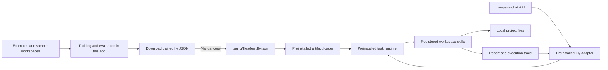

# Train here, run in xo-space: portable Fly agents

Status: training-app implementation available, 19 September 2026. Report Scout
now creates, teaches, trains, tests, persists, and exports workspace policies in
this app. The xo-space runtime, artifact loader, and adapter remain deferred
until the training experience is accepted. No xo-space code or deployment
directory has been changed. This replaces the earlier connected Fly Service proposal.

See [the Report Scout training guide](fly-task-training.md) for the current UI,
model behavior, dataset format, limits, verification commands, and measured
synthetic results. Open `/fly?studio=workspace` to use the implementation.
xo-space source reference: development at
`ead92cc4c6ae8db220f9842c7a7174e397828bb3`.

## Confirmed product contract

- This app creates, trains, tests, and exports flies.
- Training produces one self-contained JSON containing learned weights and the
  configuration required to interpret them.
- The user manually copies the JSON into the .quirq folder on the xo-space host.
- The later deployment requires xo-space to have the Fly skeleton, inference
  runtime, skills, and adapter preinstalled. It will execute tasks locally using
  the imported policy.
- The first task family inspects workspace files, extracts data, and produces
  reports. Begin with JSON/CSV inputs and defined extraction fields.
- After deployment, the fly does not require this app to be running or reachable.

Target deployment flow: create Fern → teach with sample workspaces → train and evaluate →
download fern.fly.json → copy to ~/.quirq/flies/fern.fly.json → reload flies in
xo-space → select Fern in chat → run a task against a local project.

The flow through JSON download is implemented. Copying that JSON into an
unmodified xo-space installation does not yet create an agent.

The deployment boundary is a versioned file format. No live connection, remote
training endpoint, shared database, or synchronization service is required.

## Architecture



| Training app owns | xo-space owns | JSON carries |
| --- | --- | --- |
| Examples, training, validation, export | Discovery, inference, tools, chat, execution state | Identity, learned policy, task contracts, configuration, provenance |

One installed Fly adapter serves many flies. Creating another fly produces
another data artifact, not another adapter or generated executable.

## The task brain is different from the flight brain

The existing Scent Seekers SARSA policy maps odor/wind features to left, straight,
or right. Its 270 weights cannot perform workspace tasks merely by attaching
tools. The separate `report-scout-v1` task family now has its own observations,
actions, feature schema, weights, and evaluation.

Preserve the navigation lab and old navigation exports. A fly can later carry
multiple versioned capabilities, but a scent policy must never be accepted as a
workspace policy. Success in a scent arena is not evidence of file-task ability.

The current task policy learns which unread file to inspect next. Deterministic
skills provide listing, parsing, extraction, and reporting mechanics. A later
host supplies real file access and may add versioned aggregation skills.
An optional language model translates prose into a task specification; it is
configured separately in xo-space. The JSON is not a newly trained general-purpose
language model.

## First useful task and execution loop

Initial example: “Inspect the experiment JSON/CSV files in this project, extract
the requested metrics, and produce a comparison report with source references.”

The current implementation accepts column names, dotted paths, and JSON pointers
for requested fields. Filters, aggregates, richer output formats, PDF
interpretation, OCR, arbitrary coding, and document reasoning are extensions;
they are not supported by the initial artifact contract.

Target host execution loop:

```text
Chat request
  → validate TaskSpec and bind the selected fly
  → observe task state and available file metadata
  → construct eligible candidate actions
  → score candidates with the learned policy
  → execute one registered skill
  → record the actual result and update state
  → repeat until complete, partial, failed, or cancelled
  → return the report, evidence, and execution summary
```

Task steps advance when tool results arrive. They do not use the navigation
model's 0.12-second physics clock. The fly avatar can visualize this task state.

The implemented task template is `{query, fields, maxReads}` under the
`extract-fields-v1` contract. `query` informs file-metadata scoring; `fields`
controls deterministic extraction; `maxReads` sets the read budget. A report
remains partial while files are unread or parsing errors remain. Future host
configuration supplies real workspace scope and additional execution limits.

Candidate actions currently identify unread files under `inspect-file-v1`.
Listing, extraction after each read, and final report production are fixed
runtime steps. The policy chooses candidate IDs; it does not invent arbitrary
paths or commands. A broader operation-selection policy, clarification action,
or learned stopping rule requires a new compatible contract. The future host
checks every operation against its skill registry and access rules.

## One shared implementation, two environments

`src/fly/tasks/core.js` already contains pure JavaScript task schemas, artifact
validation, feature extraction, candidate construction, policy inference, state
updates, and deterministic extraction/report logic. Browser workers and Node
verification use this same module. Package and pin it for the later host runtime;
do not maintain a second inference implementation.

- In this app, a virtual filesystem contains user-selected examples and generated
  fixtures. Training runs in a browser worker.
- In xo-space, a host bridge reads real files and returns the same normalized
  observations and skill results. Policy inference runs in the installed Node runtime.
- Python owns the adapter, sessions, host access, cancellation, and local run records.
  Only the host bridge accesses real workspace paths.

Invoke bounded Node calls through xo-space's `utils.commands.run`, using fixed
argv, JSON stdin, a timeout, and separate stderr. Begin with calls per decision;
a persistent worker can replace this transport later if profiling warrants it.
The app ships no runtime code inside the JSON.

Normalize file ordering, path tokens, candidate IDs, CSV parsing, numeric
handling, and tie-breaking across both environments. Golden fixtures must produce
identical features, choices, extracted facts, and reports in browser and Node.

Keep existing scent physics and regression tests intact. Reuse the lab's worker,
records, evaluation, and visual components through small interfaces where useful;
workspace training does not require rewriting the navigation engine.

## How training works

The implemented policy is `linear-file-ranker-v1`:

```text
score(candidate) = weights · features(observation, candidate)
```

Train from demonstrated action choices using cross-entropy over eligible
candidates. At execution, choose the highest-scoring eligible candidate with a
specified deterministic tie rule: sorted relative path. Its 19 weights and fixed
feature contract are included in the JSON; this version has no fitted normalizer.

Current features include file type, filename/path/query overlap, metadata path
categories, directory depth, log file size, requested-field name overlap,
remaining read budget, and useful-read fraction. Only unread files become
candidates. Observed headers, tool-error features, generic action costs, and
other richer observations would need a future feature version. Unread fixture
content and expected answers never enter the current policy features.

A training collection currently contains:

- Workspaces with task templates and relative file paths/text contents.
- Human decisions with candidate feature vectors, a chosen index, workspace
  ID/content binding, source, selected path, and timestamp.
- Generated teacher decisions derived from complete requested records in the
  training workspaces. These labels are generated separately from policy features.

Read results and reports are produced during actual rollouts. A future host
feedback format can add recorded tool results and outcome corrections without
changing the current training package into executable code.

Files alone are not action demonstrations. The implemented teaching mode records
human choices; a deterministic teacher supplies labeled bootstrap examples.
Human choices supersede generated labels for identical visible decisions.
Training updates numeric weights. Editing a task template alone is configuration.

Split by whole workspace/project and collection source. Reserve separate
validation and test workspaces. Evaluate full tool rollouts alongside action
prediction loss, comparing the current filename-matching and seeded-random
baselines on the same test projects. Validation does not update weights.

Current rollout summaries measure relevant-file coverage, useful-read precision,
mean reads, complete-report rate, all-relevant-files-found rate, and mean parsing
errors. Tests separately verify extraction and source correctness. The future
host may add latency and cost measurements. A learned ranker is most useful when
many irrelevant files compete for limited inspection budget. If a deterministic
workflow performs equally well, disclose that result.

Reports identify covered files, missing fields, parse errors, and complete or
partial status with a reason. A subset aggregate must never appear exhaustive.
The report builder uses extracted facts with file and JSON-record/CSV-row
references; an optional language summary does not replace that evidence.

## Portable JSON contract

| Field | Required content |
| --- | --- |
| format, schemaVersion | Deployment artifact type and schema |
| fly | Stable ID, name, revision |
| taskFamily | report-scout-v1 |
| policy | Schema, family, feature version, seed, 19 numeric weights, trained epoch count |
| contracts | TaskSpec, observation, action and skill versions; runtime compatibility |
| task | Query, extraction fields, and read budget pinned during training |
| requestedCapabilities | Registered operations needed; these do not grant host permissions |
| training | Trainer/code version, dataset/split digests, seed, hyperparameters, policy hash, cumulative lineage |
| evaluation | Dataset digest, test IDs, policy hash, compact learned/filename/random summaries |
| scope | Description of the policy's limited role and required installed skills |
| integrity | SHA-256 of canonical JSON payload with the integrity member omitted |

The artifact must contain a complete inference payload. It contains no executable
code, credentials, absolute training-machine paths, full training corpus, transient
run state, or external weight URL requiring this app to remain online.

Optional knowledge and additional policies need their own versioned payloads.
A language provider, if required by a mode, is an explicit host dependency. It is
not silently downloaded or bundled as part of a small policy JSON.

The exporter and shared validator check schemas, dimensions, finite values, size
limits, compatible versions, and the embedded integrity digest. Canonical JSON
sorts object keys recursively and preserves array order; it omits `integrity`
when hashing, so the digest is not self-referential. The future xo-space loader
can additionally hash the complete file bytes for its immutable version store.
Neither digest establishes authorship or competence. Exact field allowlists
exclude source files, reports, tool traces, unknown capabilities, and runtime code.

Existing `observatory-fly` exports retain their navigation/replay meaning. The
new deployment artifact has a distinct format and a clearly named export action.

## Host discovery and lifecycle

Proposed default layout:

```text
~/.quirq/
  flies/
    fern.fly.json                 # user-copied artifact
    versions/<sha256>.json         # immutable validated snapshots
  fly-runtime/
    catalog.json                  # fly IDs and selected artifact digests
    sessions/                     # pinned bindings and messages
    runs/                         # task state, evidence, reports
  settings/fly.json               # host workspace/tool/model configuration
```

Resolve paths through `services.storage.paths.quirq_state_dir()` and the existing
settings layout helper, respecting deployment overrides. Portable JSON contains
requested capabilities; effective access is their intersection with host grants.
Workspace bindings, output destinations, and maximum budgets remain host-owned.
Reports appear in chat; saving one uses an authorized destination.

On startup or explicit Reload flies, scan only the top-level deployment files.
Validate each independently. Reject ambiguous duplicate IDs and incompatible
versions. A malformed or partially copied file must not hide valid flies or
replace a previously accepted revision. Display actionable import errors.

Store each accepted file as an immutable digest-addressed snapshot. New sessions
use the selected revision; ongoing sessions and runs keep their pinned snapshot.
Copying a retrained file and reloading changes the catalog, not a running task.
Previous snapshots support rollback.

Weights stay frozen during host execution. Session memory and tool traces are
separate from learned policy. Later, export a feedback JSON from xo-space, import
it here, label/correct decisions, retrain, and deploy another revision. This keeps
the manual file workflow and requires no training service on xo-space.

## Preinstalled xo-space integration

Proposed code:

```text
config/agents/fly/{manifest.json,settings.json,capabilities.json}
services/cowork_agent/adapters/fly/
  adapter.py       # Adapter = FlyAdapter; run, stream, health
  paths.py
  artifacts.py     # validation, discovery, immutable versions, catalog
  agents.py        # metadata for imported flies
  models.py        # selectable fly profiles
  sessions.py      # ownership, pinned bindings, transcripts
  runtime.py       # bounded task loop, persistence, cancellation
  tools.py         # registered skills and host access
  language.py      # TaskSpec parser and optional language provider
  routes.py        # reload/list/status
<installed shared Fly Node runtime>
```

The training app consumes the same pinned core package. Do not maintain copied
browser and host inference implementations. Adapter settings.json is required
by the existing loader; the manifest and Adapter alias enable discovery.

Use the existing Plane B chat contract:

```http
POST /api/chat/prompt
Content-Type: application/json

{"text":"Inspect the experiment files and report the requested metrics.",
 "agent_name":"fly","agent_id":"orchard-study","model":"fly/fly-fern"}
```

Here agent_id retains the selected project, while model selects the imported fly.
The response supplies stream_id and session_id; the client opens
GET /api/chat/stream/{stream_id}. These endpoints already exist; Fly profiles and
the adapter are proposed.

The adapter honors the public session ID passed as our_session_id, persists
messages before completion, and yields existing token/done events. Bind each
session to fly ID, artifact digest, project, host grants, and language config.
Subsequent turns recover that binding. Do not map a fly ID into the project ID.
Check actual host/project access; Composio-derived user_id alone is not universal
authorization.

Explicit commands or task templates can produce TaskSpec without a language
model. Natural-language translation can use a separately configured xo-space
provider. Fully offline operation uses explicit commands or an available local
language model. No task request goes to the training app.

Long tasks have persistent run IDs. Implement actual cancellation between bounded
skills; current chat abort is not sufficient. Record action IDs and results so
reconnect does not duplicate operations. Reconcile interrupted actions before
retrying; report writes use stable destinations and idempotent atomic replacement.

Several current profile/session/adapter-route surfaces depend on the active
backend. Use AGENT_NAME=fly for the first contract test. Complete normal
coexistence through a fly picker and generic backend-aware listing/routing.
Copying JSON works after the compatible runtime is installed; it cannot teach an
unmodified xo-space how to load a new agent format.

## Delivery status and next stages

| Phase | Deliverable | Acceptance gate |
| --- | --- | --- |
| 1. Training app — implemented | Shared core, virtual workspaces, data/teaching UI, worker learning, independent test comparisons, persistent specimens, validated JSON import/export | Confirm the training experience in this app; browser and Node verification use the same core |
| 2. Host contract — deferred | Pin the shared inference package; implement loader, registered real-file skills, and minimal Fly adapter | Copy a trained artifact and obtain a source-linked report through chat with this app closed |
| 3. Host lifecycle — deferred | Reload/errors, profiles/history, pinned revisions, budgets/cancellation, backend coexistence | Update a copied artifact without changing an active session; verify access boundaries and recovery |
| 4. Extensions — deferred | Feedback-file retraining, richer task families, optional document/language skills | Explicit compatible contracts reuse the same artifact/runtime infrastructure |

The next xo-space implementation starts after the training experience is accepted.
It uses the existing trained export and reference fixtures; it does not add a
training API or require a running connection to this app.

Meaningful gates include browser/Node parity, held-out projects, feature leakage,
partial-report honesty, malformed imports, revisions, two-fly session isolation,
workspace access boundaries, duplicate requests, restart recovery, and actual
cancellation. Preserve current Fly tests/build; run xo-space venv tests and route
parity checks for integration changes. Documentation-only work requires no
application test run.

Scent Seekers, Changing World, and Evolution Arena can reuse identity, versioning,
records, and export infrastructure. Their policies and task metrics remain
explicitly distinct from workspace-task learning.

## Verified repository basis

The proposal uses the previously inspected
[adapter contract](https://github.com/quirq-ai/xo-space/blob/ead92cc4c6ae8db220f9842c7a7174e397828bb3/services/cowork_agent/adapters/base.py),
[discovery](https://github.com/quirq-ai/xo-space/blob/ead92cc4c6ae8db220f9842c7a7174e397828bb3/services/cowork_agent/registry/adapter_registry.py),
[required settings](https://github.com/quirq-ai/xo-space/blob/ead92cc4c6ae8db220f9842c7a7174e397828bb3/services/cowork_agent/registry/settings.py),
[chat router](https://github.com/quirq-ai/xo-space/blob/ead92cc4c6ae8db220f9842c7a7174e397828bb3/routers/cowork_agent/chat.py),
[route mounting](https://github.com/quirq-ai/xo-space/blob/ead92cc4c6ae8db220f9842c7a7174e397828bb3/routers/cowork_agent/__init__.py),
[chat UI](https://github.com/quirq-ai/xo-space/blob/ead92cc4c6ae8db220f9842c7a7174e397828bb3/space_ui/js/views/chat.js),
[command runner](https://github.com/quirq-ai/xo-space/blob/ead92cc4c6ae8db220f9842c7a7174e397828bb3/utils/commands/__init__.py),
and [configured state root](https://github.com/quirq-ai/xo-space/blob/ead92cc4c6ae8db220f9842c7a7174e397828bb3/services/storage/paths.py).

The training UI, task core, worker, persistence, portable export, tests, and audit
now live in this repository. The scent-navigation model remains separate.
xo-space code, host deployment directories, and host services remain unchanged.
